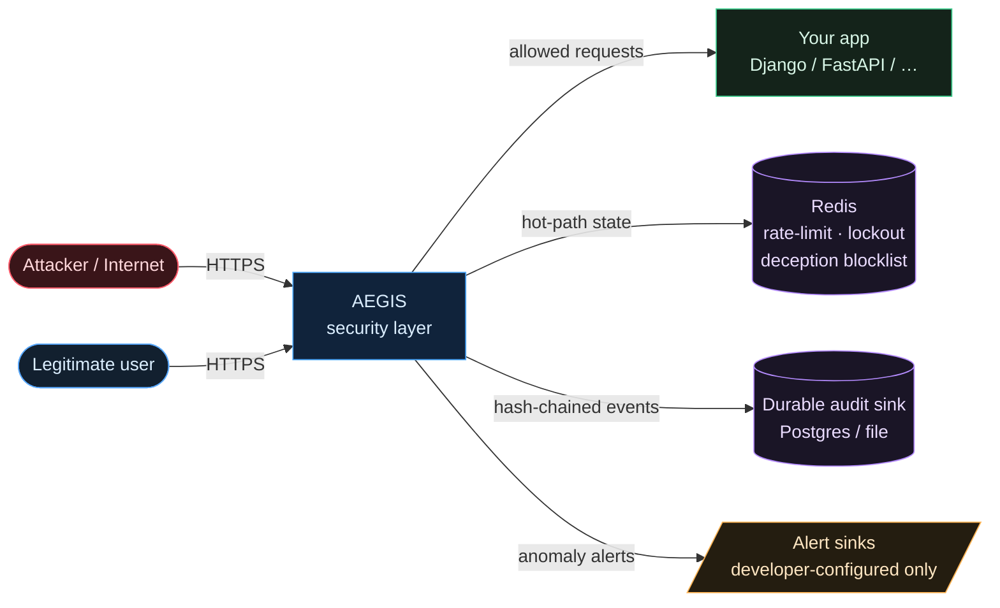
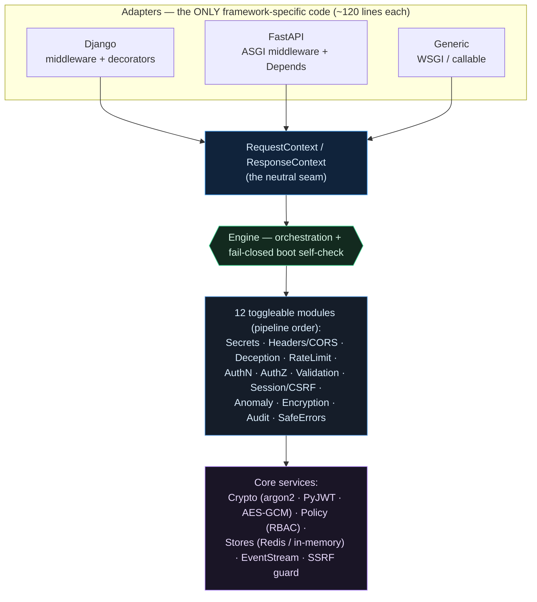
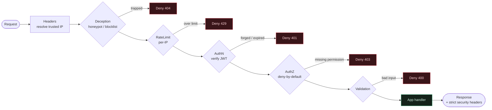
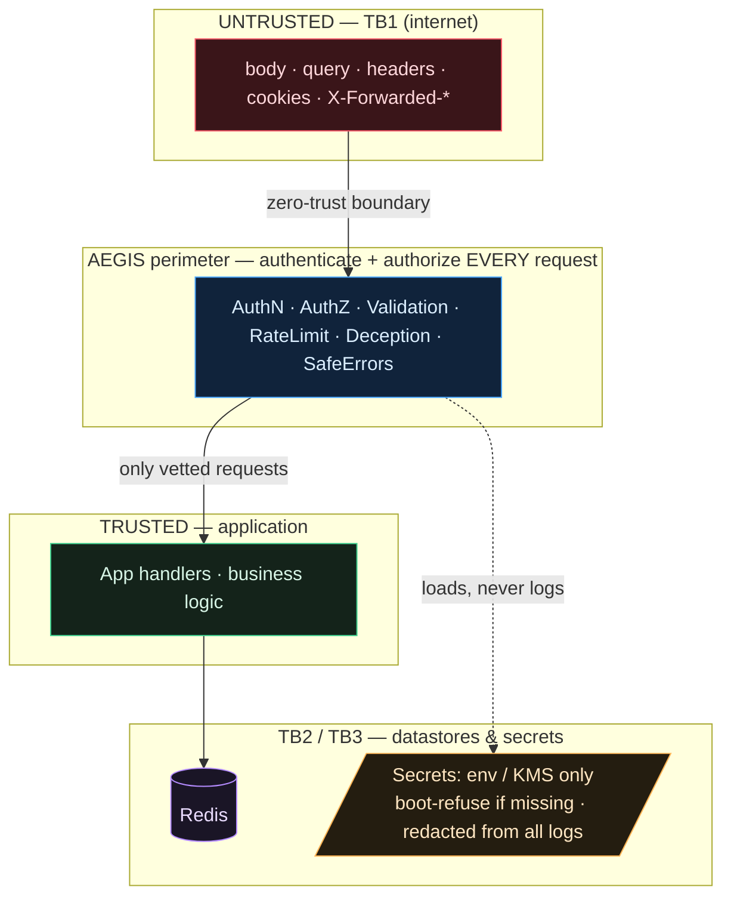
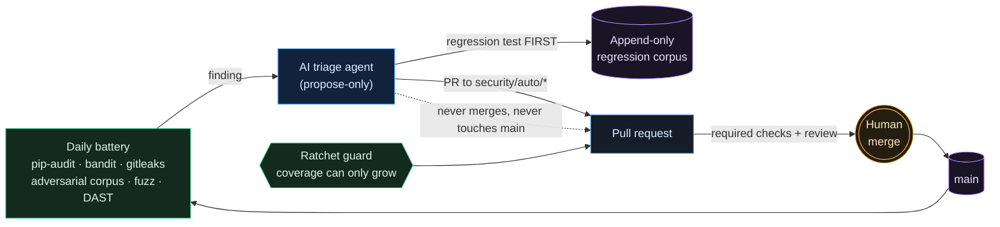

# AEGIS Architecture

Diagrams-as-code (Mermaid) — they render on GitHub, live next to the code, and diff in
review. Five views, each accurate to the current source: **system context**, **component**,
the **request pipeline**, **trust boundaries**, and the **self-hardening loop**.

---

## 1. System context

Where AEGIS sits: at the HTTP perimeter, in front of your app, backed by Redis for hot-path
state and developer-configured sinks for the audit trail and alerts. It never phones home —
egress goes only to sinks you configure (Principle 7).

---

## 2. Component — one core, thin adapters

The core claim (Requirement B): **all** security logic lives in a framework-agnostic core;
each framework needs only a thin adapter that builds a neutral `RequestContext`. A new
stack = one new adapter, **zero core changes** (Django, FastAPI, and Generic all feed the
same engine).

---

## 3. Request pipeline (fail-closed gauntlet)

Every request runs the ordered modules; the first violation **denies** (fail-closed). DoS
guards run before expensive auth; the response is hardened on the way out.

*Store unreachable (Redis down) while a limit/lockout check is needed → **deny**, not
allow-through. Missing secret / wildcard CORS / TLS-not-expected in prod → **refuse to
boot**.*

---

## 4. Trust boundaries

The threat model's boundaries (TB1–TB4). Everything crossing from the internet is
untrusted; AEGIS is the zero-trust perimeter; secrets are loaded but never logged.

---

## 5. The self-hardening loop

How AEGIS gets *monotonically* stronger — safely. The agent **proposes**; a human
**approves**; the ratchet guard guarantees coverage can only grow. The agent can never
merge or touch `main`.

---

*These diagrams trace directly to the code: the module order is `aegis/core/engine.py`'s
`_MODULE_ORDER`; the adapters are `aegis/adapters/`; the loop is `.github/workflows/` +
`security/`. See [THREAT_MODEL.md](../THREAT_MODEL.md) for the boundaries and STRIDE table
they summarize.*
